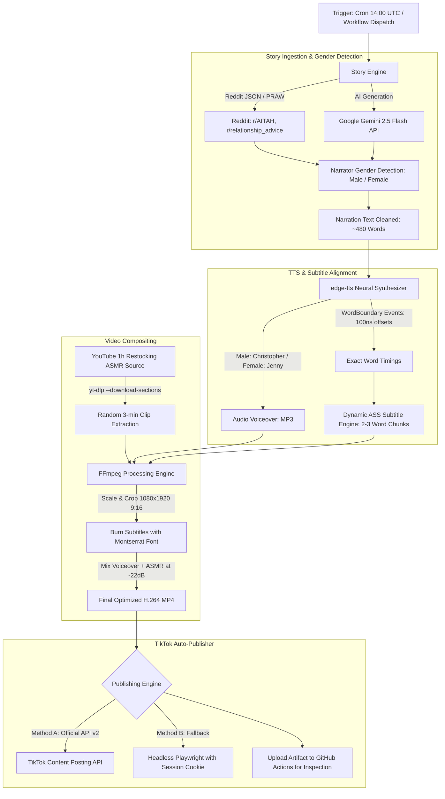

# 🎬 Automated TikTok Video Generation & Publishing Pipeline

[](.github/workflows/generate_and_publish.yml)
[](https://www.python.org/)
[](https://ffmpeg.org/)
[](https://github.com/rany2/edge-tts)
[](https://github.com/yt-dlp/yt-dlp)
[](LICENSE)

A production-ready, fully automated end-to-end pipeline designed to run on scheduled **GitHub Actions**. It generates viral 3-minute TikTok-style Reddit storytime videos featuring **dynamic word-by-word animated subtitles**, **gender-matched neural AI narration**, and **randomized satisfying ASMR restocking video clips**, automatically published to TikTok.

---

## 📌 Architecture Overview



---

## ✨ Key Features

1. **Diverse Viral Story Engine (`src/story_generator.py`)**:
   - **Rich Drama Beyond Standard AITA**: Features viral story formats inspired by top TikTok story accounts (`r/TrueOffMyChest`, `r/EntitledPeople`, `r/pettyrevenge`, `r/familydrama`, `r/relationship_advice`, `r/confession`, `r/MaliciousCompliance`, `r/tifu`).
   - Automatically cleans titles and narrative hooks (converts forum prefixes into high-retention TikTok hooks, strips trailing boilerplate).
   - **Zero-Credentials Autonomous Database**: Queries live Reddit JSON feeds, top monthly viral posts, or the 270,000+ public Reddit stories dataset without requiring any API keys.
   - **Google Gemini 2.5 Flash (`google-genai`)**: Generates diverse high-suspense story scripts across 5 viral themes (family vacation betrayal, entitled roommate karma, petty revenge, wedding drama, inheritance feuds).
   - Automatically detects narrator gender (`[24M]`, `[28F]`, `I am a 30 year old man`, contextual pronouns) with 50/50 fallback if ambiguous.
   - Enforces target word counts (450–520 words) for an exact ~3-minute video.

2. **Ultra-Realistic Neural TTS (`src/tts_engine.py`)**:
   - Powered by `edge-tts` (zero cost, zero API keys required) with `boundary="WordBoundary"` precision streaming.
   - Voice Profiles:
     - **Male**: `en-US-ChristopherNeural` (fallback: `en-US-GuyNeural`)
     - **Female**: `en-US-JennyNeural` (fallback: `en-US-AriaNeural`)
   - Emits exact word-level timing boundaries for frame-accurate caption synchronization, with an automatic proportional timing estimator backup.

3. **Viral Animated Subtitles Centered in the Middle (`src/subtitles.py`)**:
   - Produces formatted **Advanced SubStation Alpha (`.ass`)** subtitles.
   - Positioned **directly in the center of the screen** (`Alignment: 5`, vertical middle center at $y=960$).
   - High-retention TikTok visual styling:
     - Font: **Montserrat ExtraBold** (76pt, bold uppercase).
     - Color: Primary white (`&H00FFFFFF&`), strong black border outline (`&H00000000&`, thickness: 5), subtle drop shadow.
     - **Active Word Animation**: Spoken words dynamically pop and highlight in **Bright Yellow** (`&H0000FFFF&`) with scale pop (`\fscx106\fscy106`).

4. **Multi-Source Background Video Slicing (`src/video_composer.py`)**:
   - **Hugging Face Direct Video (`BACKGROUND_VIDEO_FALLBACK_URL`)**: Extracts a **fresh random clip matching the video's exact duration on every run** using high-speed remote HTTP Range seeking via FFmpeg or `yt-dlp`. Never downloads unnecessary video data.
   - **YouTube Primary/Secondary Source**: Extracts 3-minute clips from the [Satisfying Restocking ASMR compilation](https://www.youtube.com/watch?v=9or33zyZJgM) with `yt-dlp --download-sections "*START-END"`.
   - **Seamless Audio & Looping**: Includes `-stream_loop -1` to guarantee background video never cuts short, scales and crops to **vertical 9:16 (1080x1920 at 30fps)**, and ducks background ASMR to **-22dB**.
   - **Procedural Background Fallback**: If remote video servers are unreachable, generates dynamic animated satisfying visual spirals.

5. **Dual-Method TikTok Publisher (`src/tiktok_uploader.py`)**:
   - **Method A (Primary)**: TikTok Official Content Posting API (`POST /v2/post/publish/video/init/`) with automated token refresh.
   - **Method B (Fallback)**: Headless **Playwright** browser automation using a stored session cookie (`TIKTOK_SESSION_ID`).
   - Automatically appends viral tags: `#storytime #redditstories #asmr #restock #satisfying #fyp`.

---

## 🚀 Repository Structure

```
tiktok-video-pipeline/
├── .github/
│   └── workflows/
│       └── generate_and_publish.yml    # Daily cron & manual trigger workflow
├── fonts/
│   ├── Montserrat-ExtraBold.ttf        # Custom bold subtitle font
│   └── README.md                       # Font licensing details
├── src/
│   ├── __init__.py
│   ├── config.py                       # Configuration & environment variables
│   ├── story_generator.py              # Reddit ingestion & Gemini story engine
│   ├── tts_engine.py                   # edge-tts voiceover & word timestamps
│   ├── subtitles.py                    # Dynamic ASS subtitle generator
│   ├── video_composer.py               # yt-dlp section download & ffmpeg compositing
│   ├── tiktok_uploader.py              # Official API & Playwright publishing
│   └── main.py                         # Master CLI orchestrator
├── tests/
│   ├── __init__.py
│   ├── test_story_generator.py         # Story cleaning & gender detection tests
│   ├── test_tts_subtitles.py           # Subtitle timing & chunking tests
│   └── test_video_composer.py          # Video compositing helper tests
├── .env.example                        # Template for local environment secrets
├── .gitignore                          # Excludes media, cache, and secrets
├── requirements.txt                    # Pinned Python dependencies
├── Dockerfile                          # Containerized execution environment
└── README.md                           # Documentation & setup guide
```

---

## 🔐 GitHub Secrets Configuration

To run this pipeline automatically on GitHub Actions, go to your repository on GitHub:
**Settings $\to$ Secrets and variables $\to$ Actions $\to$ New repository secret** and add the following keys:

| Secret Name | Required? | Description |
| :--- | :---: | :--- |
| `GEMINI_API_KEY` | Optional | Google Gemini API key from [Google AI Studio](https://aistudio.google.com/) for generating stories. (Reddit is used if omitted). |
| `TIKTOK_ACCESS_TOKEN` | Recommended | User Access Token from [TikTok Developer Portal](https://developers.tiktok.com/) with `video.upload` and `video.publish` scopes. |
| `TIKTOK_CLIENT_KEY` | Optional | TikTok App Client Key (used for automatic access token refresh). |
| `TIKTOK_CLIENT_SECRET` | Optional | TikTok App Client Secret (used for token refresh). |
| `TIKTOK_REFRESH_TOKEN` | Optional | TikTok OAuth Refresh Token. |
| `TIKTOK_SESSION_ID` | Optional | Web cookie `sessionid` from tiktok.com for Playwright headless browser fallback. |
| `REDDIT_CLIENT_ID` | Optional | Reddit Script App Client ID (public JSON is used if omitted). |
| `REDDIT_CLIENT_SECRET` | Optional | Reddit Script App Client Secret. |
| `BACKGROUND_VIDEO_FALLBACK_URL` | Optional | Hugging Face or direct MP4 URL to 1-hour satisfying restocking background video. Extracts a random clip on each run. |
| `YOUTUBE_COOKIES` | Optional | YouTube cookies export (`yt_cookies.txt`) for datacenter IP anti-bot bypass. |

> [!TIP]
> If neither `TIKTOK_ACCESS_TOKEN` nor `TIKTOK_SESSION_ID` is provided, the workflow will generate the complete video and save it as an inspectable **GitHub Workflow Artifact** without failing.

---

## 💻 Local Quickstart

### 1. Prerequisites
- Python 3.11+
- [FFmpeg](https://ffmpeg.org/download.html) installed and in your system PATH.

### 2. Installation
```bash
git clone https://github.com/robzzzzu-cmd/tiktok-video-pipeline.git
cd tiktok-video-pipeline

# Create virtual environment
python -m venv .venv
source .venv/bin/activate  # On Windows: .venv\Scripts\activate

# Install dependencies
pip install -r requirements.txt
playwright install chromium
```

### 3. Environment Setup
```bash
cp .env.example .env
# Edit .env with your keys
```

### 4. Running the Pipeline Locally
```bash
# Full generation and mock upload (dry-run)
python -m src.main --dry-run

# Generate video and skip uploading completely
python -m src.main --skip-upload

# Force story source and voice gender
python -m src.main --source gemini --gender female --dry-run
python -m src.main --source reddit --subreddit AITAH --gender male --dry-run

# Upload an existing generated video
python -m src.main --upload-only output/tiktok_video_20261011_040000.mp4
```

### 5. Running Tests
```bash
pytest tests/ -v
```

---

## 🛠️ CLI Options

| Argument | Default | Choices | Description |
| :--- | :---: | :---: | :--- |
| `--source` | `auto` | `auto`, `reddit`, `gemini` | Source for story ingestion. |
| `--gender` | `auto` | `auto`, `male`, `female` | Narrator voice gender. `auto` detects from story markers. |
| `--subreddit` | `None` | Any subreddit name | Specific subreddit to fetch from. |
| `--dry-run` | `False` | Flag | Simulates TikTok upload without contacting remote servers. |
| `--skip-upload`| `False` | Flag | Leaves video in `output/` and skips publishing. |
| `--keep-temp` | `False` | Flag | Preserves intermediate `.mp3`, `.ass`, and raw `.mp4` slices. |
| `--upload-only`| `None` | Path | Uploads an already rendered MP4 file to TikTok. |

---

## 📦 Docker Support

You can run the entire pipeline inside a container:

```bash
docker build -t tiktok-pipeline .
docker run --rm -v $(pwd)/output:/app/output --env-file .env tiktok-pipeline --dry-run
```

---

## 📄 License
This project is licensed under the MIT License. See [LICENSE](LICENSE) for details.
